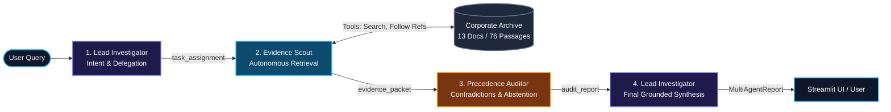

# Context Archaeologist 🧭

An autonomous **multi-agent AI system** that investigates corporate workplace archives to reconstruct decision histories, uncover stale records and contradictory claims, trace cross-document dependencies, validate citations, and honestly report unresolved questions.

Unlike standard chatbots or generic RAG systems that blindly retrieve isolated chunks and guess answers, **Context Archaeologist** coordinates three specialized, LLM-backed agents via a stateful LangGraph workflow running against a local Ollama model (`llama3:latest`).

---

## 🎯 What Problem Does It Solve?

In corporate environments, critical decisions (such as product launch dates, compliance approvals, and architecture sign-offs) become fragmented across meeting minutes, RFCs, chat channels, emails, and Jira tickets. Outdated notes linger, draft proposals are mistaken for binding approvals, and informal chat remarks contradict formal council votes.

**Context Archaeologist** solves this by:
1. Conducting autonomous, multi-round investigations across an enterprise document archive.
2. Evaluating **temporal precedence** and **document authority** (e.g. binding Launch Council resolutions supersede informal chat updates or draft proposals).
3. Demonstrating **epistemic humility**: when records are absent from the archive (e.g. missing rehearsal run records or unverified exports), it explicitly abstains rather than hallucinating outcomes.
4. Guaranteeing **100% citation grounding** against indexed passage IDs.

---

## 🚀 How It Works



1. **Lead Investigator (Assignment)**: Classifies user query intent (e.g. `status_assessment`, `gap_analysis`, `timeline_reconstruction`) and formulates a targeted search mission.
2. **Evidence Scout (Retrieval)**: Executes autonomous, multi-round tool calls (`search_archive`, `follow_references`, `get_document_details`, `inspect_timeline`) to gather primary evidence.
3. **Precedence Auditor (Analysis)**: Runs deterministic contradiction analysis via `ArchaeologyReasoner`, interprets conflict resolutions with LLM assistance, checks citation validity, and triggers epistemic abstention if evidence is missing.
4. **Lead Investigator (Synthesis)**: Synthesizes the verified findings into a cohesive, evidence-backed answer citing verified passage identifiers.

---

## 🛠️ Technology Stack

| Component | Technology | Purpose |
|:---|:---|:---|
| **Multi-Agent Orchestration** | [LangGraph](https://github.com/langchain-ai/langgraph) (`StateGraph`) | Cyclic/sequential state passing, typed handoffs, and workflow execution. |
| **Local LLM Inference** | [Ollama](https://ollama.com/) (`llama3:latest`, 8.0B) | Local, private inference for intent classification, query expansion, contradiction interpretation, and grounded synthesis. |
| **Fuzzy & Lexical Search** | [RapidFuzz](https://github.com/maxbachmann/RapidFuzz) | Fast in-memory token-ratio and partial-ratio scoring over passage corpora. |
| **User Interface** | [Streamlit](https://streamlit.io/) | Web workbench showing observable agent handoffs, evidence inspect tabs, and archive catalog. |
| **Test & Validation** | [pytest](https://docs.pytest.org/) | Deterministic test harness verifying 14 regression and robustness scenarios. |

---

## 📁 Repository Structure

```
ContextArchaeologist/
├── app.py                                # Streamlit web application with agent handoff trace
├── architecture.md                       # Comprehensive technical architecture specification
├── progress.md                           # Detailed implementation, verification & milestone record
├── README.md                             # Developer onboarding and project guide
├── src/
│   ├── agents/                           # 3-Agent Multi-Agent Implementation
│   │   ├── investigation_state.py        # Shared InvestigationState TypedDict & HandoffEntry
│   │   ├── lead_investigator.py          # Lead Investigator (assign_node & synthesize_node)
│   │   ├── evidence_scout.py             # Evidence Scout (scout_node with iterative retrieval)
│   │   └── precedence_auditor.py         # Precedence Auditor (audit_node with contradiction audit)
│   ├── multi_agent_graph.py              # LangGraph StateGraph compiling the multi-agent workflow
│   ├── ingestion.py                      # Archive ingestion engine (parses raw markdown & metadata)
│   ├── tools.py                          # Grounded Python tools (search, traverse references, validate)
│   ├── reasoner.py                       # Temporal & authority contradiction engine
│   ├── llm_client.py                     # Local Ollama client (HTTP /api/generate wrapper)
│   ├── langgraph_agent.py                # Legacy single-agent workflow (preserved for baseline tests)
│   └── orchestrator.py                   # Legacy orchestrator (superseded)
├── tests/
│   ├── test_scenarios.py                 # 10 core evaluation scenarios (10/10 PASS)
│   └── test_robustness_unseen.py         # 4 unseen robustness scenarios including DOC-013 (4/4 PASS)
└── context_archaeologist_dataset/        # Synthetic Asterion Works / Northstar archive
    ├── documents/                        # 13 raw markdown/txt workplace documents
    ├── metadata/                         # document_manifest.json, passage_index.json, claim_evidence_map.json
    ├── evaluation/                       # evaluation_questions.json (evaluation benchmark)
    └── scripts/                          # validate_dataset.py (dataset integrity validator)
```

---

## ⚡ Quick Start & Setup

### Prerequisites
- Python 3.10+ (tested on Python 3.14 / 3.11).
- Local [Ollama](https://ollama.com/) instance installed and running (optional for deterministic test runs; required for live LLM inference).

### 1. Clone & Environment Setup
```powershell
# Clone the repository
git clone https://github.com/nishantwhat/ContextArchaeologist.git
cd ContextArchaeologist

# Create and activate virtual environment
python -m venv .venv
.venv\Scripts\activate

# Install dependencies
pip install -r requirements.txt
```

### 2. Configure Local Model (Ollama)
```powershell
# In a separate terminal, ensure Ollama is serving
ollama serve

# Pull the target model
ollama pull llama3:latest
```
*Note: If Ollama is offline or times out, the system automatically falls back to deterministic heuristic evaluation so the application and test suite remain fully functional.*

### 3. Launch Streamlit Application
```powershell
python -m streamlit run app.py
```
Open your browser at `http://localhost:8501`.

---

## 🔍 Example Investigation

### Question (Asterion Works — Project Northstar)
> *"What is preventing Northstar from receiving a launch date now? Identify the gates and the evidence currently missing."*

### Agent Workflow Progression
1. **Lead Investigator (`assign_node`)**:
   - Classifies query as `gap_analysis` / `status_assessment`.
   - Delegates search mission: *"Identify Northstar release gates, launch council decisions, and incomplete prerequisites."*
2. **Evidence Scout (`scout_node`)**:
   - Searches archive and traverses references across `DOC-008` (Launch Council Decision), `DOC-009` (Release Candidate Walkthrough), `DOC-004` (Disaster Recovery Plan), `DOC-006` (Security Sign-off), and `DOC-005` (Customer Ops).
   - Packages 28 passages into the `EvidencePacket`.
3. **Precedence Auditor (`audit_node`)**:
   - Reconciles `DOC-008` (authoritative decision: date unconfirmed until 4 gates pass) against outdated or draft dates (`DOC-003`, `DOC-007`).
   - Identifies 4 incomplete/conditional gates:
     1. *Product Acceptance*: Conditional on duplicate-notification retest (`DOC-009-P03`).
     2. *Security Approval*: Missing final access-control export (`DOC-006-P02`, `DOC-011-P03`).
     3. *Recovery Rehearsal*: Run record absent from archive (`DOC-004-P04`, `DOC-010-P03`).
     4. *Customer Operations*: Rota unfrozen and FAQ unapproved (`DOC-005-P02`).
4. **Lead Investigator (`synthesize_node`)**:
   - Generates grounded executive synthesis with validated citations (`DOC-008-P02`, `DOC-009-P03`, `DOC-006-P02`, `DOC-004-P04`, `DOC-005-P02`).

---

## 🧪 Testing & Validation

The test suite validates both functional retrieval correctness and agentic robustness:

```powershell
# 1. Verify Dataset Structural Integrity
python context_archaeologist_dataset/scripts/validate_dataset.py
# Result: PASS (13 documents, 76 passages, 0 errors, 0 warnings)

# 2. Run Test Suite (14 Tests)
python -m pytest tests/ -v
# Result: 14 passed in ~7s
```

### Test Coverage Highlights:
- **`tests/test_scenarios.py` (10 tests)**: Validates target launch dates (`EVAL-01`), 4 blocking release gates (`EVAL-02`), timeline reconstruction (`EVAL-03`), draft calendar rejection (`EVAL-04`), informal chat reconciliation (`EVAL-05`), security missing artifacts (`EVAL-06`), recovery rehearsal epistemic abstention (`EVAL-07`, `EVAL-08`), and corroboration baselines (`EVAL-10`).
- **`tests/test_robustness_unseen.py` (4 tests)**: Validates unseen document handling (`DOC-013` Operational Risk Addendum), formal rejection of gate waivers, cross-document insurance dependencies, and out-of-archive abstentions.

---

## 📖 In-Depth Technical References

For deeper architectural breakdowns and execution histories, consult:
- **[architecture.md](file:///c:/Users/nishantwhat/CODE/ContextArchaeologist/architecture.md)**: Deep dive into the LangGraph state schema, per-agent LLM prompts, tool contracts, sequence diagrams, and error handling.
- **[progress.md](file:///c:/Users/nishantwhat/CODE/ContextArchaeologist/progress.md)**: Exhaustive development record detailing each phase, dataset audit corrections, performance benchmarks, and design decisions.