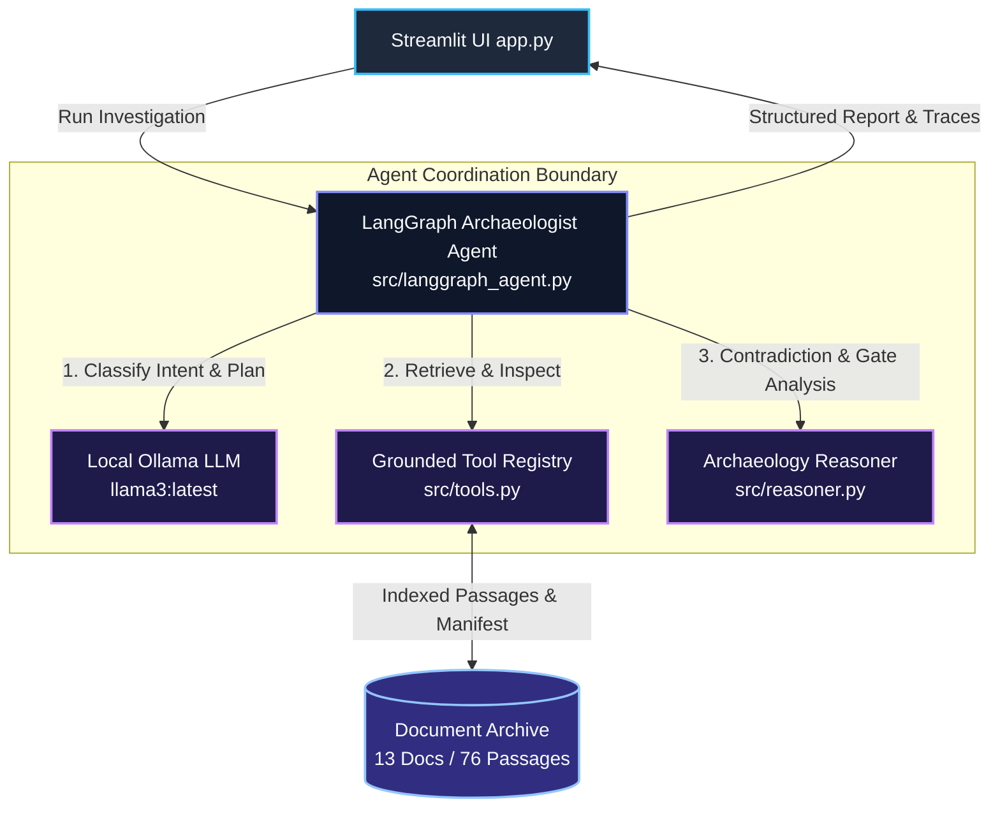
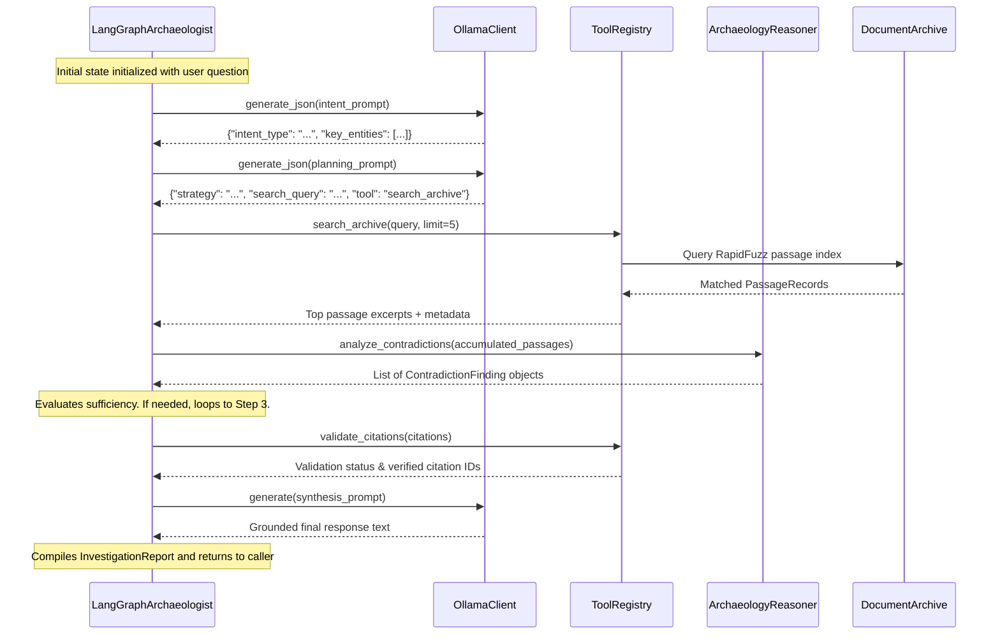

# Agent Understanding Document — Context Archaeologist

This document provides a detailed breakdown of the agent architecture within **Context Archaeologist**. It describes the agent inventory, responsibilities, placement, interactions, orchestration, tooling, and operational boundaries.

---

## 1. Agent Inventory & Structural Model

Context Archaeologist employs an **Agentic Investigation Pattern** centered around a dedicated autonomous agent coordinating specialized reasoning and tool sub-modules:

| Agent / Subsystem Entity | Class / Module | Purpose |
|:---|:---|:---|
| **Archaeologist Agent (Primary Agent)** | `LangGraphArchaeologist` (`src/langgraph_agent.py`) | Autonomous investigation agent that analyzes query intent, plans search actions, executes tools iteratively, evaluates evidence sufficiency, triggers conditional follow-up searches, and synthesizes grounded answers. |
| **Pipeline Orchestrator (Baseline Engine)** | `ContextArchaeologistOrchestrator` (`src/orchestrator.py`) | Deterministic multi-stage orchestrator executing sequential intent resolution, retrieval, contradiction analysis, and template/rule-grounded synthesis. |
| **Temporal & Contradiction Reasoner (Sub-agent Engine)** | `ArchaeologyReasoner` (`src/reasoner.py`) | Specialized analytical engine that evaluates temporal precedence, document authority levels, release gate statuses, and pairwise claim contradictions. |
| **Citation & Epistemic Validator** | Validation Subroutine (`langgraph_agent.py:validation_node` & `src/tools.py`) | Verification module that checks citation grounding against the document manifest and detects missing evidence to trigger honest epistemic abstention. |
| **Local LLM Backend** | `OllamaClient` (`src/llm_client.py`) | Local language model interface hosting `llama3:latest` for query classification, semantic planning, and factual synthesis. |

---

## 2. Agent Responsibilities & Decision-Making Roles

### A. The Archaeologist Agent (`LangGraphArchaeologist`)
- **Inputs**: User query string (e.g., *"What is preventing Northstar from receiving a launch date now?"*).
- **Outputs**: `InvestigationReport` object containing:
  - Factual answer grounded in retrieved passages.
  - Step-by-step trace of tool invocations, inputs, and outputs.
  - Resolved contradictions with explicit authority justifications.
  - List of validated citations (e.g., `DOC-008-P02`, `DOC-009-P04`).
  - Epistemic abstention flag and rationale.
- **Decision-Making Role**:
  - Classifies user intent into distinct archetypes (`factual_lookup`, `timeline_reconstruction`, `gap_analysis`, `contradiction_check`, `status_assessment`).
  - Formulates search queries and selects appropriate retrieval tools.
  - Evaluates whether accumulated evidence is sufficient to resolve all aspects of the query or whether additional tool calls are required.
  - Dynamically breaks out of the loop once sufficient evidence is gathered or maximum iterations (3 turns) are reached.

### B. Temporal & Contradiction Reasoner (`ArchaeologyReasoner`)
- **Inputs**: List of raw evidence dictionaries containing passage excerpts, document IDs, creation dates, document types, and authority ratings.
- **Outputs**: Structured `ContradictionFinding` objects identifying:
  - Topic of conflict (e.g. *Launch Date*, *Customer Operations Gate*, *Recovery Rehearsal*).
  - Conflicting claims and specific source passages.
  - Resolution based on authority rules (Launch Council > Team Sync) and temporal precedence (newer signed decision > earlier meeting note).
- **Decision-Making Role**: Reconciles reality when multiple documents in the archive make conflicting assertions.

### C. Citation & Epistemic Validator
- **Inputs**: Accumulated candidate citations, query intent, and retrieved evidence.
- **Outputs**: Validation dictionary (`{"valid": bool, "citations": List[str], "abstention_triggered": bool, "reason": str}`).
- **Decision-Making Role**: Acts as the system's "conscience". If key records (like recovery test logs) are absent, it forces the agent to report an honest abstention rather than allowing the LLM to invent an outcome.

---

## 3. Placement within the Overall Architecture

The agent sits at the center of the application stack, decoupling the interactive Streamlit user interface from the underlying data archive and tool infrastructure:



---

## 4. Agent Interactions & Communication Flow

The agent interacts with components via clean, typed Python interfaces:



---

## 5. Orchestration, Routing, and Failure Recovery

### Orchestrator Implementation
- The agent utilizes **LangGraph's `StateGraph`** with a centralized state dictionary (`AgentState`).
- State fields include:
  - `question`: Original user question.
  - `intent`: Classified query metadata.
  - `iteration`: Current loop counter (0 to 3).
  - `retrieved_passages`: Accumulated evidence corpus.
  - `inspected_docs`: Set of documents investigated.
  - `contradictions`: Identified conflicts.
  - `is_abstained`: Epistemic status flag.
  - `steps`: Full audit trail of investigation actions.

### Routing Logic (`route_next_step`)
```python
def route_next_step(state: AgentState) -> str:
    iteration = state.get("iteration", 0)
    max_iter = state.get("max_iterations", 3)
    next_action = state.get("next_action", "")
    
    # Check if more evidence is requested and we have budget left
    if next_action == "search_more" and iteration < max_iter:
        return "continue_search"
    return "validate"
```

### Failure Handling & Resilience
- **LLM Unreachability**: Handled in `src/llm_client.py` and `src/langgraph_agent.py`. If Ollama is offline or uninstalled, the agent automatically falls back to deterministic rule-based planning and synthesis.
- **Search Misses / Zero Results**: The tool executor falls back to entity token matching and broad archive scanning if high-confidence matches are not found initially.
- **JSON Parsing Errors**: If the local LLM generates malformed JSON, `OllamaClient.generate_json()` applies regex-based JSON extraction and returns a safe fallback dictionary.

---

## 6. Tools, Frameworks, and Models Used

| Category | Technology / Framework | Details |
|:---|:---|:---|
| **Graph Framework** | `langgraph` (v0.2+) / `langchain-core` | Manages state transitions, node execution, and conditional cyclical edges. |
| **Language Model** | `llama3:latest` (8.0B parameters) | Executed locally via Ollama server (`http://localhost:11434`) at low temperature (0.1). |
| **String & Fuzzy Matching** | `rapidfuzz` (v3.14+) | Computes partial token ratios and title similarity for passage ranking. |
| **Frontend Framework** | `streamlit` (v1.44+) | Provides interactive UI, sidebar controls, and real-time state visualization. |
| **Testing Framework** | `pytest` (v9.1+) | Validates functional correctness, regression compliance, and unseen robustness. |

---

## 7. End-to-End Workflow Walkthrough: EVAL-02 (Missing Launch Gates)

To illustrate how the agent operates in practice, here is a trace of **EVAL-02**:

1. **User Request**: *"What is preventing Northstar from receiving a launch date now? Identify the gates and the evidence currently missing."*
2. **Stage 1 (Intent Analysis)**:
   - Agent classifies the query as a `gap_analysis` / `status_assessment`.
   - Identifies key entities: `["Northstar", "Launch Council", "release gates", "missing evidence"]`.
3. **Stage 2 (Planning)**:
   - Planner sets initial strategy: Locate the authoritative launch council decision and release gate criteria.
   - Selected action: `search_archive("Northstar launch date release gates missing")`.
4. **Stage 3 (Tool Execution — Iteration 1)**:
   - Tool searches passages and retrieves `DOC-008-P01` (Launch Council Decision 2026-03-30 stating no date is authorized) and `DOC-008-P02` (Mandatory 4 Release Gates).
5. **Stage 4 (Evidence Evaluation — Iteration 1)**:
   - Evaluator recognizes that 4 gates exist (Product, Customer Operations, Security, and Recovery Rehearsal), but evidence on the status of each individual gate is incomplete.
   - Decides `next_action = "search_more"` and targets follow-up queries: `search_archive("recovery rehearsal data integrity")` and `search_archive("Customer Operations rota FAQ")`.
6. **Stage 3 (Tool Execution — Iteration 2)**:
   - Executes follow-up searches, retrieving `DOC-004` (Disaster Recovery Plan), `DOC-010` (Engineering Slack Sync), `DOC-005` (Customer Ops notes), and `DOC-006` (Security Sign-off).
7. **Stage 4 (Evidence Evaluation — Iteration 2)**:
   - `ArchaeologyReasoner` detects:
     - Recovery rehearsal run record is missing from archive (no official signed completion).
     - Customer Operations rota is unfrozen and FAQ unapproved.
     - Security sign-off is conditional on pending export verification.
     - Product conditional requirements remain open.
   - Evaluator marks evidence as sufficient (`next_action = "proceed_to_synthesis"`).
8. **Stage 5 (Validation)**:
   - Verifies all citations against `passage_index.json`.
   - All passages (`DOC-008-P01`, `DOC-008-P02`, `DOC-004-P03`, `DOC-005-P02`, `DOC-006-P01`, `DOC-010-P02`) validate with 100% precision.
9. **Stage 6 (Synthesis)**:
   - The agent constructs the final response detailing the 4 blocked gates, citing the governing documents, and documenting the absent recovery rehearsal report.

---

## 8. Agent Boundaries & Constraints

To maintain high trustworthiness and prevent AI hallucinations, the agent operates under explicit behavioral boundaries:

### What the Agent MUST Do
- **Must distinguish authority**: Treat signed executive decisions (`DOC-008`) as authoritative over informal Slack conversations (`DOC-005`, `DOC-010`) or outdated proposals (`DOC-001`).
- **Must provide citations**: Every substantive factual statement must cite one or more valid passage IDs.
- **Must exercise epistemic humility**: If evidence for an event or metric (e.g. disaster recovery elapsed time or external ISO audit date) is absent from the archive, it must explicitly abstain rather than invent an answer.
- **Must preserve auditability**: Every tool call and evaluation decision must be recorded in the investigation step history.

### What the Agent MUST NOT Do
- **Must NOT hallucinate unrecorded outcomes**: The agent cannot assume a gate passed simply because an informal chat said it "looked promising".
- **Must NOT access evaluation ground truth**: The agent is restricted to `documents/` and public metadata; it never accesses `evaluation/eval_scenarios.json` during live investigations.
- **Must NOT execute arbitrary system commands or external network calls**: All tool interactions are bounded strictly to the local `DocumentArchive` index.
- **Must NOT run unbounded loops**: Investigation loops are strictly bounded by `max_iterations = 3` to prevent runaway token or resource consumption.
