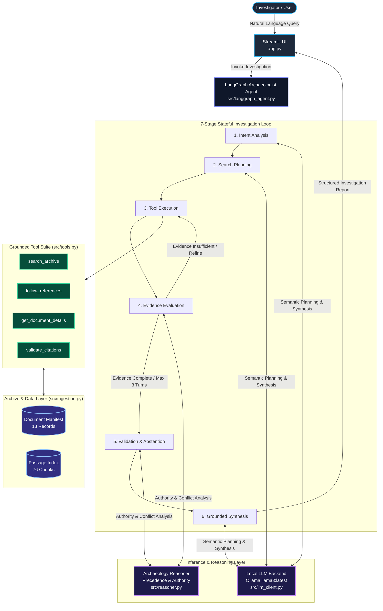
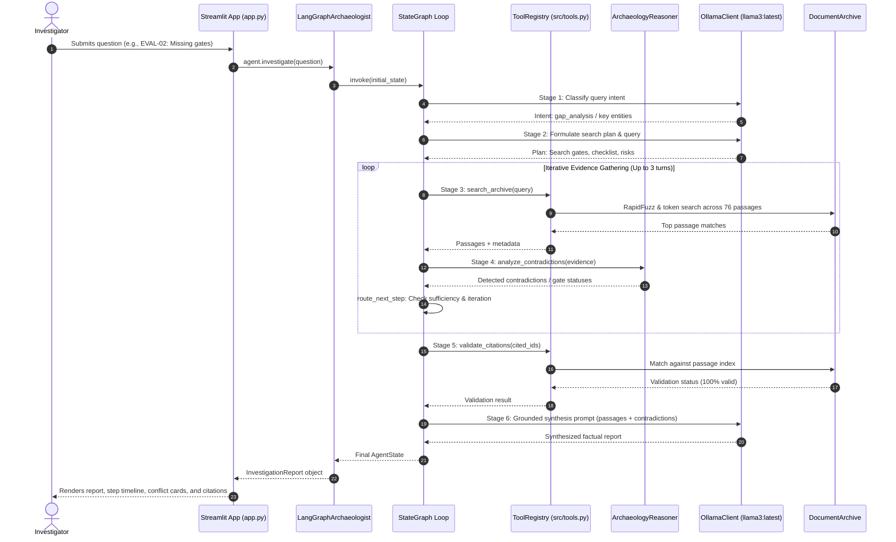

# System Architecture — Context Archaeologist

This document outlines the complete architectural design and data flow of **Context Archaeologist**, an autonomous agentic AI system engineered to investigate corporate workplace archives, resolve cross-document contradictions, trace decision histories, enforce rigorous citation grounding, and practice honest epistemic abstention.

---

## 1. High-Level Architecture Overview

Context Archaeologist is designed with strict separation between **interactive presentation**, **agentic orchestration and reasoning**, **grounded retrieval tools**, and **ingestion & storage**. The architecture is implemented around a stateful LangGraph loop with local LLM integration (Ollama `llama3:latest`) and a deterministic fallback engine.

---

## 2. System Layers & Subsystems

### A. Presentation Layer (`app.py`)
- **Technology**: Streamlit web interface with custom CSS design tokens.
- **Key Functions**:
  - **Investigation Workbench**: Allows free-form user query entry or one-click execution of evaluation benchmarks (`EVAL-01` through `EVAL-10`, plus custom unseen test cases).
  - **Live State & Trace Inspection**: Displays real-time progress across all 7 investigation stages, including raw tool inputs/outputs, iteration counts, and decision rationale.
  - **Reconciliation & Contradiction Cards**: Renders side-by-side claim conflict cards showing conflicting documents, authority levels, dates, and resolution rationale.
  - **Epistemic Humility Visuals**: Prominently highlights abstentions when evidence is incomplete or absent.
  - **Archive Catalog**: Interactive explorer for documents (`DOC-001` to `DOC-013`), versions, authority hierarchy, and passage chunks.

### B. Agentic Orchestration Layer (`src/langgraph_agent.py` & `src/orchestrator.py`)
- **Primary Engine**: `LangGraphArchaeologist` implemented as a compiled `StateGraph` over typed state `AgentState`.
- **Alternative / Baseline Engine**: `ContextArchaeologistOrchestrator` providing a fast, deterministic multi-stage pipeline.
- **Workflow Lifecycle**:
  1. **Intent Analysis Node**: Classifies the query (`factual_lookup`, `timeline_reconstruction`, `gap_analysis`, `contradiction_check`, `status_assessment`).
  2. **Planner Node**: Generates targeted keywords, selects initial tool, and scopes document types.
  3. **Tool Executor Node**: Invokes designated tools against the document archive, gathers structured passages and metadata, and appends to accumulated evidence.
  4. **Evaluator Node**: Gauges evidence sufficiency, detects unaddressed sub-questions, runs contradiction analysis via `ArchaeologyReasoner`, and determines if follow-up search is warranted.
  5. **Conditional Router (`route_next_step`)**: Evaluates iteration count against threshold (max 3 iterations); returns `continue_search` to loop back to tool execution or `validate` to advance.
  6. **Validation Node**: Runs citation verification against the real passage index and performs epistemic checks (e.g. absent run records or missing test outputs).
  7. **Synthesis Node**: Synthesizes a factual, evidence-grounded report with authoritative document reconciliation and formal passage citations.

### C. Reasoning & Analytical Engine (`src/reasoner.py`)
- **Core Components**:
  - **Authority Hierarchy**: Recognizes binding status (e.g., formal Launch Council decisions in `DOC-008` override informal team syncs in `DOC-005` or draft proposals in `DOC-001`).
  - **Temporal Precedence**: Orders decisions by effective timestamp, identifying superseded milestones (e.g., April 20 vs. May 11 vs. indefinite gate hold).
  - **Contradiction Detection**: Identifies conflicting launch dates, conflicting release gate claims, and conditional approvals.
  - **Epistemic Completeness**: Scans for missing verification evidence (such as the unrecorded recovery rehearsal in `DOC-004`/`DOC-010`).

### D. Grounded Tool Suite (`src/tools.py`)
All tools are Python functions operating directly on the ingested archive:
- `search_archive(query, limit, doc_type)`: Combines RapidFuzz partial string matching, document/passage title matching, token overlap scoring, and direct ID boosting.
- `get_document_details(doc_id)`: Retrieves full text, metadata, authors, and referenced IDs.
- `get_passage_details(passage_id)`: Fetches exact excerpt, section name, and document ID.
- `follow_references(doc_id)`: Traverses explicit document references bidirectionally.
- `inspect_timeline(topic)`: Reconstructs a chronological view of documents, versions, and events.
- `validate_citations(citations)`: Validates that every citation exists in the manifest and passage index.

### E. Model & Inference Backend (`src/llm_client.py`)
- **Backend**: Local **Ollama** server hosting `llama3:latest` (8.0B parameters).
- **Communication**: JSON REST API calls over HTTP (`/api/generate` and `/api/tags`) with a robust configurable timeout (default 120s, configurable via `OLLAMA_TIMEOUT`) and low temperature (0.1) for factual precision.
- **Fail-Safe Mechanism**: Automatic detection via `is_available()`. In addition, all LangGraph nodes feature try-except fallback to deterministic semantic heuristics on timeout, ensuring uninterrupted investigation even during heavy CPU/GPU loads.

### F. Ingestion & Storage Layer (`src/ingestion.py`)
- **Dataset Location**: `context_archaeologist_dataset/`
- **Data Stores**:
  - `documents/`: 13 synthetic markdown/text files representing an enterprise project archive (`DOC-001` through `DOC-013`).
  - `metadata/document_manifest.json`: Public catalog detailing metadata, author, authority level, creation/update dates, and passage ID lists.
  - `metadata/passage_index.json`: 76 pre-indexed passages with section names and raw text.
- **Evaluation Isolation**: `evaluation/` ground-truth files and scenarios are never indexed or accessed by live search tools.

---

## 3. Data Flow Diagram

The following sequence illustrates the life cycle of an investigation request:

---

## 4. Component Implementation Status

| Component / Module | Implementation Status | Notes |
|:---|:---|:---|
| **Document Ingestion** (`src/ingestion.py`) | **Implemented & Tested** | Ingests 13 documents and 76 passages; isolated from evaluation ground truth. |
| **Tool Registry** (`src/tools.py`) | **Implemented & Tested** | 6 callable tools using RapidFuzz scoring and reference traversal. |
| **Reasoner Engine** (`src/reasoner.py`) | **Implemented & Tested** | Analyzes temporal precedence, authority levels, gate statuses, and contradictions. |
| **Local LLM Client** (`src/llm_client.py`) | **Implemented & Tested** | Ollama `llama3:latest` integration with JSON output parsing and timeout protection. |
| **LangGraph Agent** (`src/langgraph_agent.py`) | **Implemented & Tested** | 7-stage stateful loop with conditional edge routing and deterministic test fallback. |
| **Orchestrator** (`src/orchestrator.py`) | **Implemented & Tested** | Grounded deterministic pipeline used for fast regression validation. |
| **User Interface** (`app.py`) | **Implemented & Tested** | Streamlit UI displaying interactive investigation traces, contradiction diffs, and catalog. |
| **Automated Test Suite** (`tests/`) | **Implemented & Tested** | 14/14 automated tests passing (10 regression scenarios + 4 robustness/unseen queries). |

---

## 5. Security, Boundaries & Design Invariants

1. **No Ground Truth Leakage**: Ingestion reads only `documents/` and public `metadata/`. Ground-truth evaluation files (`evaluation/eval_scenarios.json`) are strictly prohibited from tool retrieval.
2. **Deterministic Fallback**: When Ollama is unreachable or when running offline tests, the system relies on deterministic semantic heuristics rather than breaking or failing silently.
3. **Mandatory Citations**: No statement in the synthesis is considered authoritative unless backed by explicit passage IDs (e.g. `DOC-008-P02`).
4. **Epistemic Humility**: When an audit record or event outcome is absent from the archive, the agent refuses to guess or assume success, explicitly marking the investigation as abstained with clear rationale.
