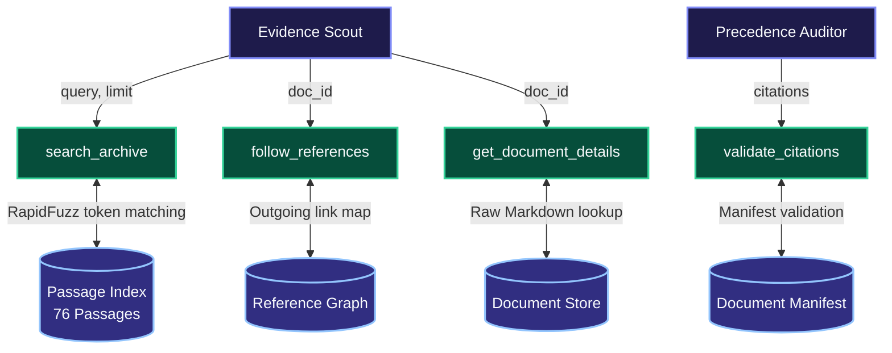
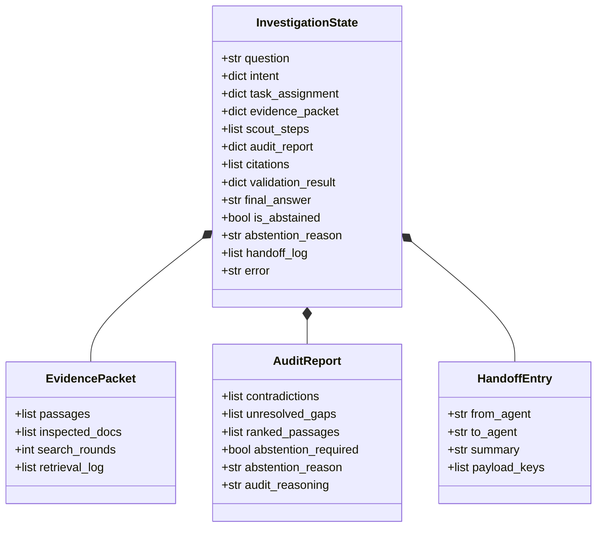
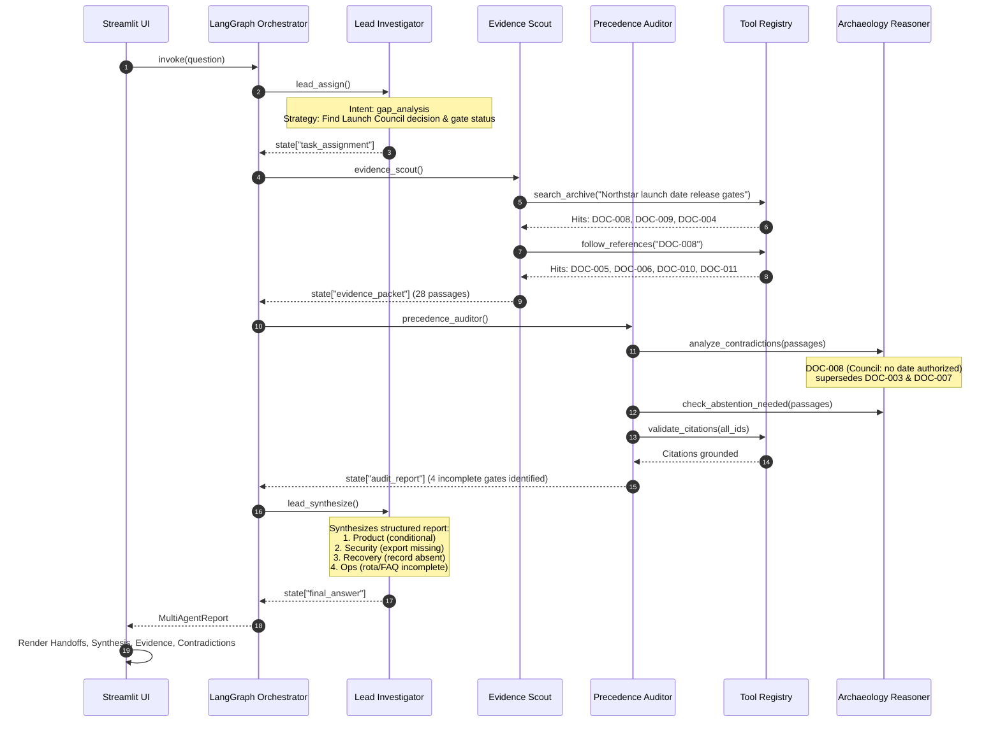

# Technical Architecture Reference — Context Archaeologist

This document serves as the authoritative technical specification for **Context Archaeologist**. It details the multi-agent architecture, coordination mechanisms, LangGraph execution graphs, shared state schema, tool implementations, and error handling.

---

## 1. System Overview & Component Topography

Context Archaeologist is structured into four distinct, loosely coupled layers:
1. **Presentation Layer**: Streamlit interface (`app.py`) providing interactive query submission, real-time observable handoffs, and an archive document browser.
2. **Multi-Agent Orchestration Layer**: LangGraph `StateGraph` (`src/multi_agent_graph.py`) coordinating three specialized agents (`LeadInvestigator`, `EvidenceScout`, and `PrecedenceAuditor`).
3. **Execution & Reasoning Layer**: Deterministic tool execution (`src/tools.py`), temporal precedence reasoning (`src/reasoner.py`), and local LLM inference (`src/llm_client.py`).
4. **Data & Storage Layer**: Parsed document manifest, passage chunks, and raw Markdown records (`src/ingestion.py`).

```mermaid
flowchart TD
    classDef ui fill:#1e293b,stroke:#38bdf8,stroke-width:2px,color:#f8fafc;
    classDef graph fill:#0f172a,stroke:#818cf8,stroke-width:2px,color:#f8fafc;
    classDef agents fill:#1e1b4b,stroke:#c084fc,stroke-width:2px,color:#f8fafc;
    classDef tools fill:#064e3b,stroke:#34d399,stroke-width:2px,color:#f8fafc;
    classDef storage fill:#312e81,stroke:#93c5fd,stroke-width:2px,color:#f8fafc;
    classDef llm fill:#78350f,stroke:#f59e0b,stroke-width:2px,color:#f8fafc;

    User([Employee / Investigator]):::ui -->|Enters Query| UI[Streamlit Web UI\napp.py]:::ui
    UI -->|invoke| MultiAgent[MultiAgentArchaeologist\nsrc/multi_agent_graph.py]:::graph

    subgraph OrchestrationGraph ["LangGraph StateGraph"]
        direction TB
        N1[1. lead_assign\nLead Investigator]:::agents -->|task_assignment| N2[2. evidence_scout\nEvidence Scout]:::agents
        N2 -->|evidence_packet| N3[3. precedence_auditor\nPrecedence Auditor]:::agents
        N3 -->|audit_report| N4[4. lead_synthesize\nLead Investigator]:::agents
        N4 -->|END| Out[MultiAgentReport]:::graph
    end

    MultiAgent --- OrchestrationGraph

    subgraph SharedStateContainer ["Shared InvestigationState"]
        direction LR
        S_intent[intent] --- S_task[task_assignment] --- S_ev[evidence_packet]
        S_aud[audit_report] --- S_cite[citations] --- S_hand[handoff_log]
    end

    OrchestrationGraph <--> SharedStateContainer

    subgraph IntelligenceLayer ["Intelligence & Inference Layer"]
        Ollama[Local Ollama Server\nllama3:latest\nsrc/llm_client.py]:::llm
        Reasoner[Archaeology Reasoner\nAuthority & Temporal Engine\nsrc/reasoner.py]:::llm
    end

    subgraph ToolRegistrySuite ["Grounded Tool Suite (src/tools.py)"]
        T_search[search_archive]:::tools
        T_doc[get_document_details]:::tools
        T_ref[follow_references]:::tools
        T_time[inspect_timeline]:::tools
        T_val[validate_citations]:::tools
    end

    subgraph CorporateArchive ["Document Archive (src/ingestion.py)"]
        Manifest[(Document Manifest\n13 Records)]:::storage
        Passages[(Passage Index\n76 Chunks)]:::storage
        RawDocs[(Raw Documents\n13 Files)]:::storage
    end

    N1 & N4 <-->|JSON Prompts & Synthesis| Ollama
    N2 <-->|Continuation Decisions| Ollama
    N2 --> ToolRegistrySuite
    ToolRegistrySuite <--> CorporateArchive
    N3 <-->|Contradiction & Precedence Analysis| Reasoner
    N3 <-->|Interpretation Prompt| Ollama
    N3 --> T_val

    Out -->|Visual Handoffs & Tabs| UI
```

---

## 2. Multi-Agent Architecture & Coordination

The system features three distinct agents. Each has explicit boundaries, inputs, outputs, and fallback behaviors:

```mermaid
flowchart LR
    classDef agent fill:#0f172a,stroke:#818cf8,stroke-width:2px,color:#f8fafc;
    classDef data fill:#1e1b4b,stroke:#c084fc,stroke-width:2px,color:#f8fafc;

    Lead[Lead Investigator]:::agent -->|task_assignment\ninitial_keywords| Scout[Evidence Scout]:::agent
    Scout -->|evidence_packet\npassages & docs| Auditor[Precedence Auditor]:::agent
    Auditor -->|audit_report\ncontradictions & abstention| LeadSynthesis[Lead Investigator\n(Synthesis)]:::agent
```

### A. Lead Investigator (`src/agents/lead_investigator.py`)
- **Role**: Executive mission controller. Understands what is being asked, breaks the question into an investigation plan, and performs grounded synthesis at the conclusion.
- **Stage 1 (`assign_node`)**:
  - *Trigger*: Initial entry point of the LangGraph workflow.
  - *LLM Prompt*: Evaluates query complexity, extracts entities, and formulates the search strategy for the Scout.
  - *Writes to State*: `intent`, `task_assignment`, and appends to `handoff_log`.
- **Stage 4 (`synthesize_node`)**:
  - *Trigger*: Triggered after the Precedence Auditor completes its audit.
  - *LLM Prompt*: Synthesizes final text strictly from verified passages and auditor contradiction resolutions.
  - *Writes to State*: `final_answer`, `citations`, `is_abstained`, `abstention_reason`, and appends to `handoff_log`.
- **Resilience**: If Ollama times out or is offline, it executes deterministic heuristic intent extraction and structured rule-based synthesis.

### B. Evidence Scout (`src/agents/evidence_scout.py`)
- **Role**: Autonomous workplace researcher. Operates in iterative retrieval rounds.
- **Stage 2 (`scout_node`)**:
  - *Trigger*: Receives state containing `task_assignment` from Lead Investigator.
  - *Execution Flow*:
    1. **Round 1**: Executes `search_archive` using initial keywords from the task assignment.
    2. **Rounds 2..N**: Calls LLM with current evidence summary to determine: (a) whether evidence is sufficient to answer the prompt, and (b) if not, which tool to call next (`follow_references`, `get_document_details`, `search_archive`).
  - *Writes to State*: `evidence_packet` (serialized `EvidencePacket`), `scout_steps`, and appends to `handoff_log`.
- **Resilience**: Falls back to following outgoing references from top-ranked documents if the LLM is unreachable.

### C. Precedence Auditor (`src/agents/precedence_auditor.py`)
- **Role**: Legal and governance conscience. Evaluates temporal precedence, checks for conflicting statements, ranks evidence authority, and enforces epistemic abstention.
- **Stage 3 (`audit_node`)**:
  - *Trigger*: Receives `evidence_packet` from Evidence Scout.
  - *Deterministic Steps*:
    1. Runs `ArchaeologyReasoner.analyze_contradictions()` to find pairwise conflicting statements across documents.
    2. Runs `ArchaeologyReasoner.check_abstention_needed()` to verify if essential records are missing.
    3. Runs `ToolRegistry.validate_citations()` to confirm citation validity.
  - *LLM Step*: Prompts Ollama to interpret the resolved contradictions in the context of the user's question.
  - *Writes to State*: `audit_report` (serialized `AuditReport`), `citations`, `validation_result`, and appends to `handoff_log`.

---

## 3. Tool-Calling Architecture

Tools in `src/tools.py` are pure, grounded Python functions backed by indexed memory structures. They have no network dependencies and never mutate source files.



### Detailed Tool Specification
1. **`search_archive(query: str, limit: int = 5) -> List[Dict[str, Any]]`**
   - *Calling Node*: `EvidenceScout.scout_node`
   - *Mechanism*: Computes RapidFuzz partial token ratios over title, section, and text content across all 76 passages.
   - *Output*: List of passage dicts (`passage_id`, `doc_id`, `excerpt`, `score`, `authority`, `created`).
2. **`follow_references(doc_id: str) -> Dict[str, Any]`**
   - *Calling Node*: `EvidenceScout.scout_node`
   - *Mechanism*: Traverses explicit outgoing cross-references recorded in document frontmatter and body links.
   - *Output*: Dict containing `source_document_id` and list of `explicit_outgoing_references`.
3. **`get_document_details(doc_id: str) -> Dict[str, Any]`**
   - *Calling Node*: `EvidenceScout.scout_node` & Streamlit Archive Catalog
   - *Mechanism*: Retrieves complete document metadata and raw markdown body.
   - *Output*: Dict containing `id`, `title`, `author`, `created`, `status`, `authority`, `content`.
4. **`validate_citations(citations: List[str]) -> Dict[str, Any]`**
   - *Calling Node*: `PrecedenceAuditor.audit_node`
   - *Mechanism*: Checks candidate passage and document IDs against the official `document_manifest.json` and `passage_index.json`.
   - *Output*: Dict with `valid_citations` and `invalid_citations`.

---

## 4. Shared State Schema & Information Flow

All data exchange occurs through LangGraph's central `InvestigationState` dictionary:



### State Mutations by Node
| Node | Reads From State | Writes To State | Appends Handoff |
|:---|:---|:---|:---|
| `lead_assign` | `question` | `intent`, `task_assignment` | `lead_investigator ➔ evidence_scout` |
| `evidence_scout` | `question`, `task_assignment` | `evidence_packet`, `scout_steps` | `evidence_scout ➔ precedence_auditor` |
| `precedence_auditor` | `question`, `evidence_packet` | `audit_report`, `citations`, `validation_result` | `precedence_auditor ➔ lead_investigator` |
| `lead_synthesize` | `question`, `evidence_packet`, `audit_report` | `final_answer`, `is_abstained`, `abstention_reason`, `citations` | `lead_investigator ➔ output` |

---

## 5. End-to-End Query Trace: EVAL-02

Here is an architectural trace of the benchmark query **EVAL-02**:

> *"What is preventing Northstar from receiving a launch date now? Identify the gates and the evidence currently missing."*



---

## 6. Precedence Reasoning & Authority Engine

`ArchaeologyReasoner` in `src/reasoner.py` provides deterministic conflict resolution:

```
[DOC-008: Launch Council Decision] (Authority 1.0) ──► GOVERNS
       ▲
       │ supersedes
[DOC-003: Baseline Strategy]       (Authority 0.8) ──► SUPERSEDED
       ▲
       │ overrides
[DOC-007: Draft Shared Calendar]   (Authority 0.4) ──► UNAPPROVED PLACEHOLDER
       ▲
       │ clarifies
[DOC-005 / DOC-010: Slack Chats]   (Authority 0.2) ──► INFORMAL PREPARATION
```

### Precedence Resolution Matrix
- **Launch Date Conflict**: `DOC-008` (30 March Launch Council) explicitly states no launch date is authorized until 4 gates pass. This legally supersedes the stale 11 May date in `DOC-003` and invalidates the unapproved draft date in `DOC-007`.
- **Customer Operations Readiness Conflict**: `DOC-005` Slack chat mentions *"Support is ready"*, but formal council decision `DOC-008` mandates that the shift rota must be frozen and the customer FAQ approved. The formal requirement governs; the gate is incomplete.
- **Security Approval Conflict**: `DOC-007` includes a draft sign-off placeholder, but `DOC-006` and `DOC-011` show Security Lead Lena Ortiz has not received the production access-control export and has issued no production approval.

---

## 7. Error Handling, Resilience & Failure Boundaries

| Potential Failure Mode | Detection Point | Handling & Recovery Behavior | User Experience in UI |
|:---|:---|:---|:---|
| **Ollama Server Offline** | `MultiAgentArchaeologist.__init__` | Automatically falls back to `require_llm=False`. All deterministic logic runs normally. | Amber warning badge: *"🟡 Ollama offline — running deterministic heuristics"*. Full investigation succeeds. |
| **LLM Inference Timeout** | `OllamaClient.generate` (`timeout=120s`) | Catches `socket.timeout` / `TimeoutError` and falls back to deterministic heuristic synthesis. | Informative notice explaining the local delay, with instructions to increase timeout if needed. |
| **Malformed LLM JSON** | `OllamaClient.generate_json` | Applies regex extraction (`\{.*\}`) and returns fallback dictionary if unparseable. | Investigation continues smoothly with default task parameters. |
| **Missing Archive Evidence** | `PrecedenceAuditor.audit_node` | Evaluates epistemic bounds; detects missing run records or future unknown dates. | Prominent purple banner: *"🛑 Epistemic Abstention Triggered"* with explicit rationale. |
| **Ungrounded Citations** | `PrecedenceAuditor.audit_node` | Compares cited IDs against `passage_index.json`. | Red warning in Validation tab identifying ungrounded citations. |

---

## 8. Architectural Trade-offs & Extension Points

### Intentional Design Choices
1. **Local-First, Zero-Cloud Inference**:
   - *Rationale*: Workplace archives contain proprietary, confidential corporate records. Keeping inference strictly local (Ollama) guarantees absolute data privacy.
2. **Deterministic Heuristic Dual-Mode**:
   - *Rationale*: LLMs can experience latency spikes on consumer hardware. Ensuring every agent node has a deterministic fallback guarantees 100% reproducible test suites (running in ~7s) and unbroken UI operation.
3. **Strict Evaluation Isolation**:
   - *Rationale*: Agent code in `src/` has zero read access to `ground_truth/` or `evaluation/` directories, preventing benchmark leakage.

### Extension Points
- **Dense Embedding Hybrid Search**: Integrate local vector embeddings (via Ollama `nomic-embed-text`) alongside RapidFuzz BM25-style lexical search.
- **Dynamic Human-in-the-Loop Approval**: Allow compliance officers to manually sign off or override an auditor's precedence resolution directly from the Streamlit UI.
