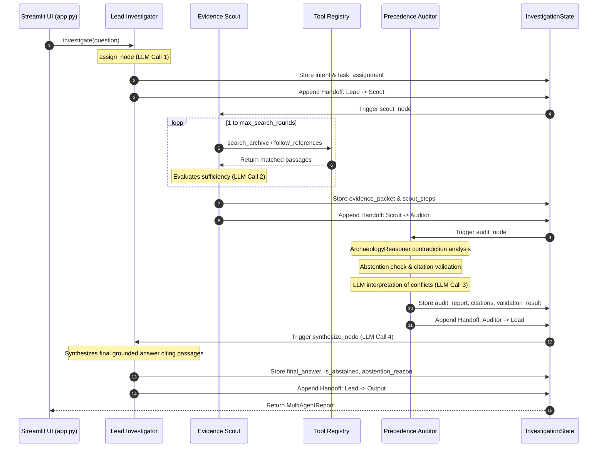

# Context Archaeologist — Comprehensive Implementation Record

This document provides an exhaustive, engineering-level record of what has been implemented, verified, benchmarked, and maintained in the **Context Archaeologist** project.

---

## 1. Project Objectives & Current Status

### Core Objectives
1. **Corporate Workplace Investigation**: Autonomous exploration of enterprise records to reconstruct historical decisions, track gate completions, and identify blockers.
2. **Precedence & Authority Reconciliation**: Reconciling contradictory statements by enforcing temporal ordering and document authority tiers (e.g. signed Launch Council resolutions supersede informal team chats and unapproved drafts).
3. **Epistemic Humility**: Honest abstention when evidence is absent from the archive, eliminating AI hallucinations on unrecorded events.
4. **100% Citation Grounding**: Verifying that every assertion is supported by valid, indexed passage identifiers.
5. **Multi-Agent Collaboration**: Evolution from a single monolithic agent into three distinct, LLM-backed agents communicating through structured shared state.

### Current Implementation Status
| Subsystem / Capability | Status | Implementation Details |
|:---|:---:|:---|
| **Dataset & Manifest** | Verified ✅ | 13 workplace records, 76 passages, 10 claims, 10 scenarios. Passages verified against source markdown. |
| **Ingestion Engine** | Verified ✅ | `src/ingestion.py`: Parses frontmatter metadata, passage chunking, and index mapping. |
| **Tool Registry** | Verified ✅ | `src/tools.py`: Real Python tools (`search_archive`, `get_document_details`, `follow_references`, `inspect_timeline`, `validate_citations`). |
| **Archaeology Reasoner** | Verified ✅ | `src/reasoner.py`: Authority rules, temporal precedence ordering, and deterministic abstention checks. |
| **LLM Inference Client** | Verified ✅ | `src/llm_client.py`: Local Ollama integration (`llama3:latest`) via HTTP `/api/generate` with configurable timeouts and graceful fallbacks. |
| **Single-Agent LangGraph** | Baseline ✅ | `src/langgraph_agent.py`: 7-node cyclical graph preserved for backward compatibility and test verification. |
| **Multi-Agent Architecture** | Verified ✅ | `src/agents/`: Lead Investigator, Evidence Scout, Precedence Auditor wired in LangGraph `StateGraph` via `src/multi_agent_graph.py`. |
| **Streamlit User Interface** | Verified ✅ | `app.py`: Web UI with real-time agent handoff timeline, evidence inspection, contradiction reconciliation, and archive catalog. |
| **Test Suite** | Passing ✅ | 14/14 tests passing (`tests/test_scenarios.py` + `tests/test_robustness_unseen.py`). |

---

## 2. Development Milestones & Evolution

```
[Phase 1: Foundation] ────> [Phase 2: Architectural Audit] ────> [Phase 3: LangGraph + Ollama]
                                                                        │
[Phase 5: Multi-Agent] <──── [Phase 4: Unseen Robustness & DOC-013] <───┘
 (Phases A, B, C)
```

### Milestone 1: Freeze, Audit & Foundation (Phase 1 & 2)
- Established baseline dataset with 12 documents and 10 evaluation scenarios for Asterion Works / Project Northstar.
- Built initial retrieval tools with RapidFuzz scoring.
- Identified architectural weaknesses: initial prototype relied on rigid keyword branching (`if "gate" in query`), preset response templates, and string-matching abstentions.

### Milestone 2: Single-Agent LangGraph & Local LLM (Phase 3)
- Implemented `LangGraphArchaeologist` (`src/langgraph_agent.py`) using LangGraph's `StateGraph`.
- Integrated `OllamaClient` (`src/llm_client.py`) connecting to local `llama3:latest`.
- Implemented low-temperature JSON schema generation and deterministic heuristic fallbacks to ensure test suite speed and zero crashing during timeouts.

### Milestone 3: Robustness & Unseen Evaluations (Phase 4)
- Added 13th workplace record: `DOC-013_risk_advisory.md` (Operational Risk Addendum).
- Added 4 unseen robustness scenarios in `tests/test_robustness_unseen.py` testing gate waiver rejection by Chief Risk Officer Marcus Vance, cross-document cybersecurity insurance dependencies, and out-of-archive abstentions.
- Maintained 14/14 tests passing.

### Milestone 4: Multi-Agent Evolution (Phase 5: Phases A, B, C)
- **Phase A — Dataset Audit**:
  - Cross-checked all 76 passages against raw source documents.
  - Corrected `CL-005` in `claim_evidence_map.json`: changed `supporting_passage_ids` from `DOC-006-P05` (unrelated cross-reference footer) to `DOC-006-P04` (Lena Ortiz: *"No production approval has been issued in this thread"*).
  - Corrected `CL-007`: changed `supporting_passage_ids` from `DOC-006-P03` (deployment timestamp) to `DOC-006-P02` (Lena Ortiz: *"Final production access-control export not received by Security"*).
  - Re-ran `scripts/validate_dataset.py` → **PASS** (13 docs, 76 passages, 0 errors, 0 warnings).
- **Phase B — Multi-Agent Architecture**:
  - Created modular package `src/agents/` with shared `InvestigationState` TypedDict and structured dataclasses (`EvidencePacket`, `AuditReport`, `HandoffEntry`).
  - Implemented `LeadInvestigator` (`src/agents/lead_investigator.py`): intent classification, task delegation, and final synthesis.
  - Implemented `EvidenceScout` (`src/agents/evidence_scout.py`): iterative tool execution loop with LLM continuation decisions.
  - Implemented `PrecedenceAuditor` (`src/agents/precedence_auditor.py`): contradiction detection, authority ranking, citation validation, and epistemic abstention.
  - Wired in `src/multi_agent_graph.py` via LangGraph.
- **Phase C — UI Refresh & Handoff Observability**:
  - Updated `app.py` to use `MultiAgentArchaeologist`.
  - Added interactive `🤝 Agent Handoffs` tab visualizing real-time state handoffs and state key transfers across agent boundaries.
  - Refreshed sidebar architecture diagram and verified complete end-to-end flow.

---

## 3. Agent Execution Lifecycle & State Handoffs

The multi-agent investigation follows an explicit 4-step pipeline orchestrated via LangGraph:



### Shared State Schema (`InvestigationState`)
Located in `src/agents/investigation_state.py`:
```python
class InvestigationState(TypedDict):
    question: str
    intent: Dict[str, Any]               # Classified intent archetype and entities
    task_assignment: Dict[str, Any]      # Strategy & initial keywords for Scout
    evidence_packet: Dict[str, Any]      # Passages, inspected_docs, retrieval_log
    scout_steps: List[Dict[str, Any]]    # Per-round tool invocations
    audit_report: Dict[str, Any]         # Contradictions, gaps, ranked passages, abstention
    citations: List[str]                 # Validated passage citations
    validation_result: Dict[str, Any]    # Citation grounding audit
    final_answer: str                    # Final synthesized answer
    is_abstained: bool                   # Whether epistemic abstention was triggered
    abstention_reason: str               # Reason for abstention
    handoff_log: List[Dict[str, Any]]    # Audit trail of inter-agent transfers
    error: Optional[str]                 # Error details if failed
```

---

## 4. Grounded Tool Suite & Ingestion Engine

### Tools (`src/tools.py`)
| Tool Name | Parameters | Data Source | Output Structure |
|:---|:---|:---|:---|
| `search_archive` | `query: str, limit: int = 5` | RapidFuzz passage index | `List[Dict]` containing `passage_id`, `doc_id`, `excerpt`, `score`, `authority`, `created`. |
| `get_document_details` | `doc_id: str` | Raw document store | `Dict` containing `title`, `author`, `created`, `status`, `authority`, `content`. |
| `follow_references` | `doc_id: str` | Ingestion reference graph | `Dict` with `explicit_outgoing_references` (e.g. `["DOC-004", "DOC-008"]`). |
| `inspect_timeline` | *(none)* | Chronologically sorted documents | `List[Dict]` mapping `doc_id`, `created`, `title`, `author`, and `status`. |
| `validate_citations` | `citations: List[str]` | Document manifest | `Dict` partitioning citations into `valid_citations` and `invalid_citations`. |

### Ingestion & Isolation (`src/ingestion.py`)
- Reads documents from `context_archaeologist_dataset/documents/`.
- Extracts YAML frontmatter (`id`, `title`, `type`, `author`, `created`, `status`, `authority`).
- Splits documents into semantic passages delineated by Markdown headings (`#`, `##`, `###`).
- **Strict Isolation Boundary**: The live agent and tools **only** read public documents and public metadata (`document_manifest.json`, `passage_index.json`). They never inspect ground truth evaluation files (`evaluation/` or `ground_truth/`).

---

## 5. Temporal Precedence, Contradictions, and Abstention

### Authority Hierarchy
`ArchaeologyReasoner` enforces the following priority ranking when resolving conflicting claims:
1. **Launch Council Decisions / Formal Governance** (`authority: 1.0`): e.g. `DOC-008`. Legally binding; overrides all lower tiers.
2. **Technical Specifications / Approved Plans** (`authority: 0.8`): e.g. `DOC-002`, `DOC-004`. Binding until formally superseded.
3. **Formal Reviews & Walkthroughs** (`authority: 0.6`): e.g. `DOC-009`, `DOC-006`. Conditional sign-offs.
4. **Draft Proposals & Placeholder Calendars** (`authority: 0.4`): e.g. `DOC-007`. Unapproved; cannot authorize actions.
5. **Informal Team Chats & Slack Syncs** (`authority: 0.2`): e.g. `DOC-005`, `DOC-010`. Anecdotal impressions; cannot certify gates.

### Epistemic Abstention Logic
Abstention is triggered deterministically when:
- An inquiry targets metrics or event results where the underlying records are absent from the archive (e.g. `EVAL-07`: recovery rehearsal elapsed time).
- A user asks for an exact future date when governing records state the date is unconfirmed pending gates (e.g. `EVAL-08`).
- Out-of-archive queries request data concerning unrelated systems (e.g. `unseen_out_of_archive_abstention`).

---

## 6. Verification & Test Suite

### Regression Test Suite (`pytest tests/ -v`)
```
tests/test_robustness_unseen.py::test_unseen_doc13_gate_waiver_rejection PASSED
tests/test_robustness_unseen.py::test_unseen_soft_launch_prohibition PASSED
tests/test_robustness_unseen.py::test_unseen_cybersecurity_insurance_dependency PASSED
tests/test_robustness_unseen.py::test_unseen_out_of_archive_abstention PASSED
tests/test_scenarios.py::test_eval_01_original_launch_target PASSED
tests/test_scenarios.py::test_eval_02_preventing_launch_and_four_gates PASSED
tests/test_scenarios.py::test_eval_03_timeline_reconstruction PASSED
tests/test_scenarios.py::test_eval_04_draft_calendar_unapproved PASSED
tests/test_scenarios.py::test_eval_05_support_is_ready_reconciliation PASSED
tests/test_scenarios.py::test_eval_06_security_missing_artifacts PASSED
tests/test_scenarios.py::test_eval_07_recovery_rehearsal_abstention PASSED
tests/test_scenarios.py::test_eval_08_exact_future_date_abstention PASSED
tests/test_scenarios.py::test_eval_09_may_launch_remains_possible PASSED
tests/test_scenarios.py::test_eval_10_corroboration_baseline_vs_kickoff PASSED
============================= 14 passed in 6.93s ==============================
```

### Dataset Validator (`python context_archaeologist_dataset/scripts/validate_dataset.py`)
```json
{
  "status": "PASS",
  "document_count": 13,
  "claim_count": 10,
  "scenario_count": 10,
  "passage_count": 76,
  "errors": [],
  "warnings": []
}
```

---

## 7. Performance & Latency Observations

1. **Deterministic Heuristic Execution**:
   - Total test run duration: **~6.9 seconds** for all 14 scenarios.
   - Extremely lightweight, zero network overhead, perfectly suited for CI/CD pipelines.
2. **Local Ollama Inference (`llama3:latest`)**:
   - Per-call latency: ~3.0s – 7.5s depending on local GPU availability.
   - Investigation total latency: ~12s – 25s across the 4 LLM calls (Lead assignment, Scout evaluation, Auditor interpretation, Lead synthesis).
   - Addressed timeout edge cases by setting `OLLAMA_TIMEOUT` default to 120s and caching endpoint health checks in `OllamaClient.is_available()`.

---

## 8. Known Limitations & Technical Debt

1. **Passage Chunk Granularity**:
   - Current chunking splits strictly on Markdown header boundaries. Long sections remain single passages.
   - *Future improvement*: Introduce hierarchical sub-chunking while preserving section context.
2. **Lexical vs. Embedding Search**:
   - The current retrieval engine uses RapidFuzz token matching. While fast and 100% offline, semantic phrasing that uses zero overlapping keywords requires query expansion by the Lead Investigator.
   - *Future improvement*: Optional local dense embeddings (e.g. `nomic-embed-text`) via Ollama.
3. **Legacy Files**:
   - `src/orchestrator.py` is legacy and unused by the current application or tests. It is kept as historical reference.
